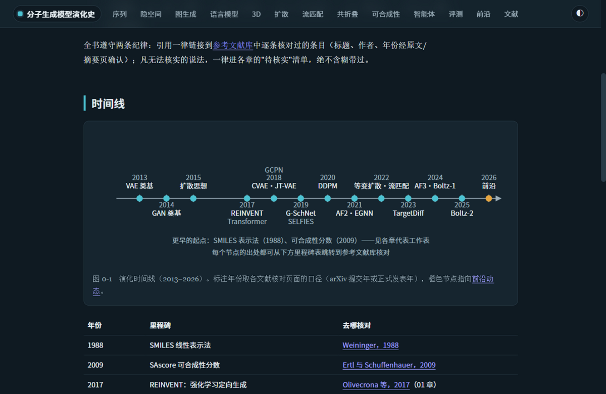
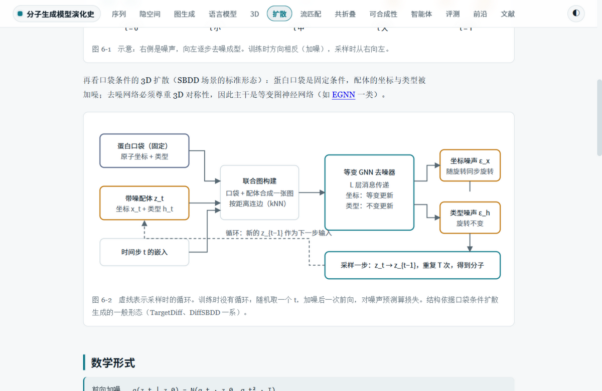
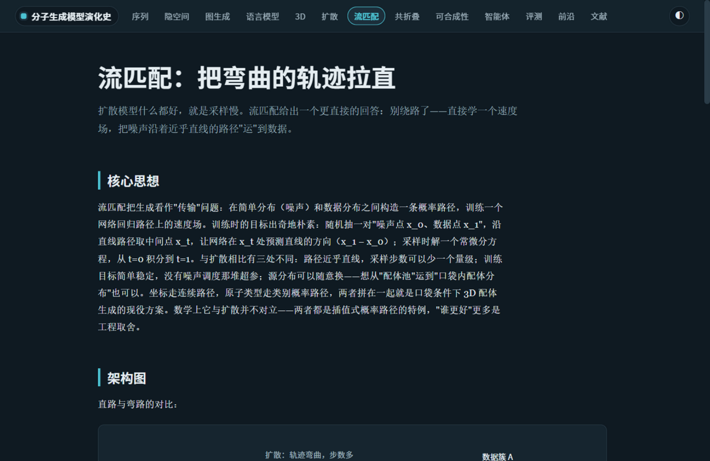
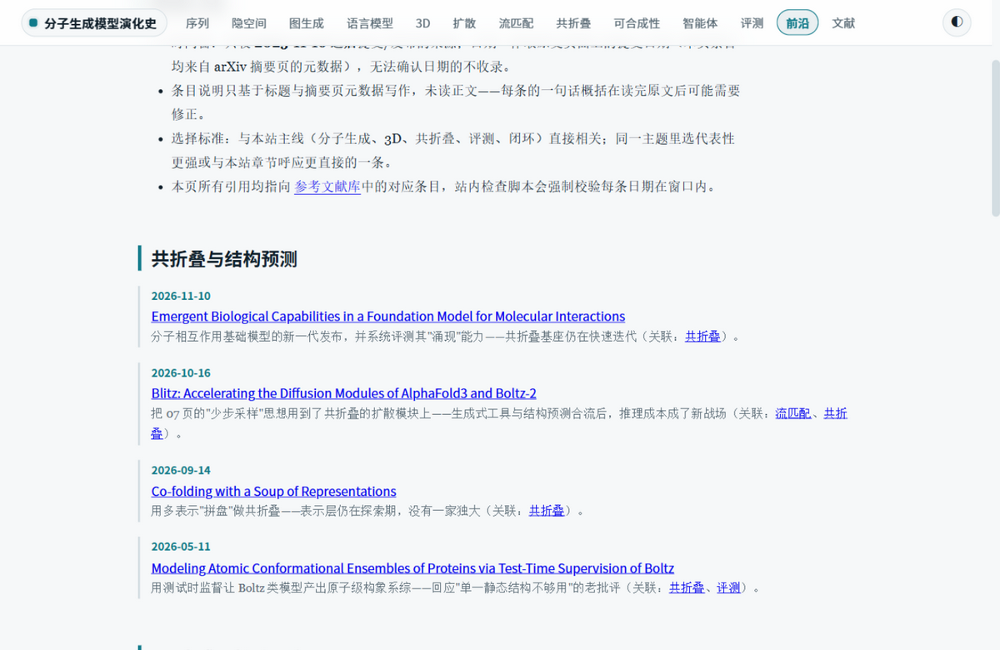
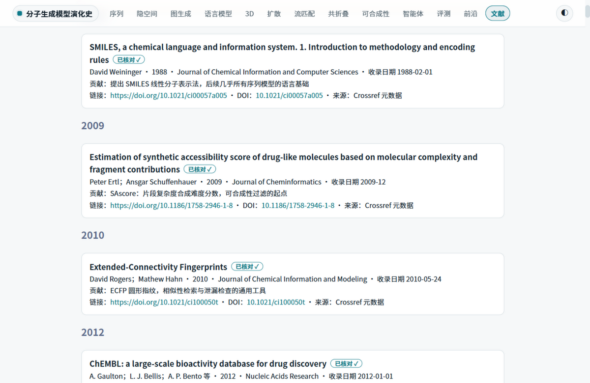

# AI 药物发现中的分子生成模型演化史

一个纯静态的知识型网站：用 14 页梳理分子生成模型在 AI 药物发现中的演化线——从 SMILES 字符串生成、隐空间与图生成、Transformer 预训练，到 3D 等变网络、扩散模型、流匹配、共折叠，再到可合成性闭环、LLM 智能体与评测体系。每个模型家族页采用同一套固定结构（核心思想 → 架构图 → 数学形式 → 代表工作 → 优点、局限与常见陷阱 → 衔接 → 待核实），全部配内联 SVG 手绘架构图。

**核心纪律**：正文 198 处引用全部指向参考文献库中 **114 条逐条核对过原文/摘要页的条目**（标题、作者、年份三项比对通过才标记 verified）；凡未能核实的说法一律进入各页"待核实"清单，不编造、不含糊。

## 预览

| 首页（浅色） | 演化时间线（深色） |
|---|---|
|  |  |

| 扩散模型架构图（06 页） | 流匹配（07 页，深色） |
|---|---|
|  |  |

| 前沿动态（12 页） | 参考文献库（13 页） |
|---|---|
|  |  |

## 在线访问

纯静态、零依赖，两种方式：

```bash
# 本地预览
cd aidd-generation-model
python -m http.server 8765
# 打开 http://127.0.0.1:8765/index.html
```

或者直接双击 `index.html`。也可将整个目录部署到 GitHub Pages / 任意静态托管（Settings → Pages → Deploy from branch → main / root）。

深浅色跟随系统，右上角 ◐ 可手动切换。

## 站点结构

| 页面 | 内容 |
|---|---|
| `index.html` | 00 总览与时间线（2013–2026，13 个里程碑全部锚定文献库） |
| `01-sequence.html` | 序列时代：SMILES-RNN、REINVENT 强化学习定向生成 |
| `02-latent.html` | 隐空间：VAE、JT-VAE、GAN |
| `03-graph.html` | 图生成：GCPN、GraphAF、MoFlow |
| `04-transformer.html` | Transformer 与化学语言模型、预训练范式 |
| `05-3d.html` | 3D 与等变网络：EGNN、口袋条件生成两条路线 |
| `06-diffusion.html` | 扩散模型（全站样板页的扩写版） |
| `07-flow.html` | 流匹配：直线路径、少步采样、离散流 |
| `08-cofold.html` | 结构预测与共折叠：AF3、Boltz、Chai |
| `09-synthesis.html` | 可合成性、逆合成与实验闭环 |
| `10-agents.html` | LLM 与智能体：ChemCrow 到自主实验室 |
| `11-eval.html` | 评测体系与常见陷阱 |
| `12-frontier.html` | 近 12 个月前沿动态（每条带核对日期） |
| `13-references.html` | 参考文献库（114 条，按年份分组，含核对徽章） |

## 方法论

- **引用核对**：`references.json` 的每条候选由程序打开原文/摘要页（arXiv `citation_*` 元标签或 Crossref API），核对标题片段、作者、年份后才写入；核对不到的候选直接剔除。原始页面缓存与修复留档在 `data/`（不入库）。
- **数字纪律**：正文不写具体基准分数——除非能从已核对页面确认；各章"待核实"清单列出未确认项（全站共 58 条）。
- **年份口径**：arXiv 条目用 v1 提交年，期刊条目用正式发表年（见 `DECISIONS.md` D-005）。

## 工具链

```bash
python -I tools/check.py          # 全站自检：内部链接 / 7 固定部分 / 引用 verified /
                                  # SVG 出界 / 12 页日期窗口 / 导航链 / 样式一致性
python -I tools/verify_refs.py    # 引用核对流水线（抓取 arXiv/Crossref 元数据）
python -I tools/gen_refs.py       # 从 references.json 生成 13-references.html
python -I tools/beautify.py       # 全站样式同步（导航/页脚）
```

## 文档

- `PROGRESS.md` — 执行进度（五阶段全记录）
- `DECISIONS.md` — 15 条构建决定与理由
- `REPORT.md` — 全站自检报告（页数 / 图数 / 引用数 / 待核实汇总）
- `BLOCKERS.md` — 阻塞项（为空）
- `diffusion-sample.html` — 风格样板页（保留原样）

## 更新前沿动态的流程

1. 在 `tools/build_refs.py` 追加候选（arXiv id + 期望标题片段 + 一句话贡献）
2. `python -I tools/verify_refs.py` 核对（失败条目不会入库）
3. 在 `12-frontier.html` 添加条目（日期取自 arXiv 提交页）
4. `python -I tools/check.py` 自检（会强制校验前沿条目日期在近 12 个月内）
5. 重新生成文献库并提交
